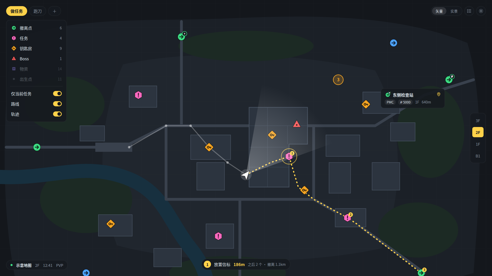

# otm

otae's tarkov minimap：逃离塔科夫的外置地图。

本地运行、免费、开源。只读取游戏截图的文件名和游戏日志，不读内存、不抓包、不注入游戏进程。

**当前状态：设计阶段，还没有可运行的程序。**

## 打算做什么

- 在副屏窗口或游戏内叠加层上显示自己的位置、朝向和楼层
- 类别筛选、自定义预设、楼层自动切换
- 自动跟踪已接取的任务，任务树和任务路线推荐
- 指向、路线、本局轨迹
- 赛季限定内容做成可替换的赛季包

位置只在按下游戏截图键时更新一次，这是不碰游戏进程的前提下固有的限制。

## 文档

- [设计文档](design/DESIGN.md)
- [效果图](design/mockups/)
- [原型脚本](design/prototypes/)

## 数据与素材来源

- 地图、任务、物品等数据来自 [tarkov.dev](https://tarkov.dev)。
- 地图图标改自 [the-hideout/tarkov-dev](https://github.com/the-hideout/tarkov-dev)（MIT）。
- 矢量地图来自 [the-hideout/tarkov-dev-svg-maps](https://github.com/the-hideout/tarkov-dev-svg-maps)（CC BY-NC-SA 4.0，不得用于外挂）。
- 赛季通行证文件的刷新点、任务地点的位置描述和现场照片来自 [逃离塔科夫中文Wiki](https://www.eftarkov.com)，经站长同意后使用。
- 物品图标、商人头像等游戏素材的版权属于 Battlestate Games。

## 协议

代码以 [MIT](LICENSE) 协议发布。上面列出的第三方数据和素材仍按各自的授权，不随代码改为 MIT；其中矢量地图带有非商业限制。

本项目与 Battlestate Games 无关。
