# otm 设计文档

otm = otae's tarkov minimap，逃离塔科夫的外置地图。

状态：讨论稿，2026-11-15。尚未开始写代码。

每条结论后面的标记：
- 无标记：已定
- 【待定】：还没讨论完，或是提了方案但没确认
- 【待核实】：依赖一个还没查清的事实

---

## 1. 定位

- 本地运行、免费、不需要账号。不加入组队房间时完全不联网（拉取地图数据除外）。
- 先自用，之后再做发布。代码全程开源。
- 立足点是三件事：界面和筛选比现有工具好用；位置刷新没有延迟；地图数据更新不必干等上游。

## 2. 红线

- 数据只来自游戏截图的文件名和游戏日志文件。
- 不读游戏内存，不抓包，不向游戏进程注入任何东西，不向游戏发送模拟按键。

由此带来的固有限制：**位置只在按下游戏截图键时更新一次**，做不到连续实时。队友位置、轨迹的精细程度都受这一条限制。

## 3. 数据来源

### 3.1 游戏本机（已在实机上验证，游戏版本 1.3.0.1）

| 数据 | 来源 | 说明 |
|---|---|---|
| 位置、朝向 | 截图文件名 | 形如 `2026-11-12[20-18]_-232.18, 21.77, 16.87_0.00034, 0.97530, 0.00399, 0.22086_5.20 (0).png`：日期时间、坐标 x y z、朝向四元数。菜单里的截图不带坐标，直接忽略 |
| 楼层 | 坐标里的高度 | 配合上游提供的各楼层高度范围判断 |
| 当前地图 | `application` 日志 | 每局有一行带 `Location: <地图名>` 和 `RaidMode` |
| 对局起止 | `application` 日志 | `GameStarting`、`GameStarted` 等记录 |
| 当前档案 | `application` 日志 | 每局带角色编号；切换模式时有 `Session mode: Pve` / `Session mode: PvpSeason` |
| 任务状态变化 | `push-notifications` 日志 | `ChatMessageReceived` 通知，带消息类型和任务编号 |

- 游戏目录从注册表的卸载信息里读取，截图文件夹在"文档\Escape from Tarkov\Screenshots"。
- 历史日志保留完整（实机上从 2023 年 1 月至今共 1477 次启动），可以回读还原任务状态。
- 日志只记录任务整体的状态变化，任务内每个小目标是否完成看不出来，需要手动勾选。
- 藏身处建造和角色等级不在日志里。
- 任务通知的类型编号（2026-11-15 对照全部历史日志确认）：10 = 接取，11 = 失败，12 = 完成。
- 模式在日志里的名称：`Regular`（普通 PVP）、`Pve`、`PvpSeason`（赛季）。2024 年 5 月之前的日志没有这一行，那时只有普通 PVP。
- 任务通知本身不带角色编号，按同一次启动里最近的 `Session mode` 归到对应模式。
- 每个角色有两个编号：PMC 一个，Scav 是它加一。进局记录里出现哪个，就知道这一局是 PMC 还是 Scav，可用来自动切换撤离点的筛选。
- **日志还原的任务进度不可靠，这是实测的结论**：
  - "完成"的通知经常缺失。实测赛季档日志里只有 35 个任务有完成记录，但从"后面的任务已经接取"能推断出另外 9 个也完成了；仍有几十个任务停在"已接取"，其中一部分很可能其实已经完成。
  - 所以进度 = 日志记录 + 按前置关系推断（接到了后面的任务，前置一定已完成）+ 手动校正。手动校正不是可有可无的补充，是必需的。
- 重置的识别：48 小时内有 3 个已完成的任务又被接取，算一次重置。实测能认出玩家活跃期间的删档，但玩家没怎么玩的那几次删档认不出来，所以还需要一份公开的删档日期表作为补充。
- 拾取赛季文件在日志里没有可用的记录，今日计数只能手动。

### 3.2 上游（tarkov.dev）

- 地图清单：每张图的底图地址、坐标换算参数、边界、楼层划分和各楼层高度范围。
- 矢量底图：分图层的 SVG，含建筑、围栏、水域、岩石、道路、楼梯、梯子、危险区、各楼层地面、上锁房间等。
- 栅格底图（实景俯视图）：瓦片形式。
- 接口：每张图的撤离点（阵营、所需开关、需支付的物品）、钥匙房（对应钥匙、是否需通电）、物资容器（类型）、出生点（阵营、类别）、Boss（刷新概率和位置）、危险区、开关、固定武器、地图间转移点；任务及其目标、所需物品、所需钥匙、目标区域。支持中文。

两种底图的覆盖情况：

| 地图 | 矢量 | 栅格 |
|---|---|---|
| 海关、森林、海岸线、储备站、立交桥、工厂、中心区 | 有 | 有 |
| 街区、灯塔、终点站 | 有 | 无 |
| 实验室、迷宫、破冰船 | 无 | 有 |

授权：
- 矢量底图是 CC BY-NC-SA 4.0，并注明不得用于外挂。otm 必须保持非商业、署名；改动后再分发须用相同授权。
- 上游的接口程序是 GPL-3.0，网站程序是 MIT，这两个是代码的授权。
- 【待核实】栅格底图和接口返回的数据本身的授权条款。
- 【待核实】静态文件 `maps` 里实际的子类清单；是否提供散落物资的点位。

处理方式：本地缓存，启动时检查一次更新，失败就用缓存。程序自带一份数据快照，上游不可用时首次启动也能用。

上游有两个取数据的入口：
- 静态文件 `https://json.tarkov.dev/regular/...`（另有 `pve/`）：`tasks`、`maps`、`traders`、`items` 及对应的中文翻译 `*_zh`。2026-11-15 实测可用。**otm 以这个为准。**
- 查询接口 `https://api.tarkov.dev/graphql`：2026-11-14 至 15 实测一直返回 422 "GraphQL server unavailable"，两台机器结果相同。不需要鉴权，原因未明，不依赖它。

## 4. 架构

- **核心 + 多种显示端**。核心负责监听文件、解析日志、管理数据和状态；显示端只负责画。
- 技术栈：Tauri。核心用 Rust，界面用网页技术，窗口模式和叠加层共用一套界面代码。
- 显示端：副屏窗口、叠加层。手机和平板通过局域网页面当副屏放在第二版，架构上留好位置。
- **支持回放**：核心把每张截图的文件名和相关日志记到自己的记录里，可以脱离游戏重放一局。用于开发测试（写代码的 Agent 进不了游戏），也用于复盘。
- 配置是一个本地文件，预设、热键、窗口位置都在里面。
- 运行和测试在装有游戏的 Windows 机器上；游戏内的实际效果由用户试。
- 界面里的外链交给系统浏览器打开：外壳装了 `tauri-plugin-opener`，权限只放行 `https://www.eftarkov.com`（赛季文件的署名链接），别的地址一律不走这条路。

## 5. 档案模型

```
角色档案（PVE / PVP / PVPS，按日志里的模式名区分）
  └─ 周目（每次转生开启一个新周目）
       └─ 任务状态
```

- 任务状态挂在"档案 + 周目"下，互不干扰。
- 跟随日志自动切换到当前档案。
- 任务初始状态靠回读历史日志得到，再按前置关系推断补全，并且必须能手动校正（见 3.1）。回读只取当前周目起点之后的记录。原型在 `prototypes/log_progress.py`。
- 转生的识别：日志里有明确记录就用；否则靠推断（已完成的任务被重新接取）；保底有一个手动"开启新周目"。
- 【待核实】转生在日志里留下什么记录。

## 6. 功能

### 6.1 位置与地图
- 进局自动切到对应地图，出局自动隐藏叠加层。
- 楼层自动切换，同时可以手动切换查看别的楼层。
- 底图可在矢量和实景之间切换；只有一种的地图用那一种。矢量底图按 otm 的配色重新上色，实景底图整体压暗。
- 支持所有地图，程序不为单张图写特殊逻辑。坐标或楼层不准的，打到哪张修哪张。

### 6.2 截图处理
- 读完坐标后直接删除这张截图，可在设置里关闭。只在对局进行中删除带坐标的截图，其他截图不动。

### 6.3 筛选
- 类别分两级：大类（撤离点、任务、钥匙房、Boss、物资、出生点、危险区、开关和固定武器、自定义标注），每个大类下可勾选子类（例如物资只显示保险箱和武器箱）。子类清单取自上游，不写死。
- 预设：一组两级类别开关，加上"仅当前任务、路线、轨迹"三个开关。用户自建、改、删、排序，数量不限，程序不内置固定预设，初始带一到两个示例。
- 预设在设置的"预设"页里编辑。
- 主窗口左侧只有大类开关，用于临时调整，不改动预设本身。
- 最终显示的 = 当前预设勾选的类别 ∩ 当前楼层 ∩（如果开了）当前任务相关。

### 6.4 任务
- 自动跟踪已接取的任务，按档案和周目分开。
- 任务点位显示在地图上，可只显示当前任务相关的点。
- 进图前提醒这张图上当前任务需要带的东西（信标、钥匙、要上交的物品）。
- 任务面板里可手动勾选小目标。

### 6.4.1 任务树与任务路线

- 数据：上游静态文件 `tasks`。503 个任务，其中 201 个有前置任务；其余靠商人等级、角色等级、剧情对话解锁。
- 任务树是和地图并列的一个视图，显示当前档案的任务进度。
- 目标：Kappa、灯塔看守人、转生、全部任务，或在树上点任意任务设为目标。
- 推荐路线的算法（原型在 `prototypes/task_route.py`，已用真实任务数据跑通）：
  1. 找出达成目标还需要做的全部任务，含前置。
  2. 挑出现在能做的。
  3. 每个任务的分数 = 1 + 它挡住的后续任务数。
  4. 按地图归拢，选总分最高的那张图作为下一局；不限地图的任务顺带做。
  5. 假设这一局做完，重复，排出后面几局。
- 局限：默认每个任务一局做完，所以给出的是顺序而不是工期；没有考虑互斥分支。
- 等级：角色等级和商人等级不在日志里。从已接取过的任务反推下限（接到过要求 15 级的任务，说明至少 15 级），并在档案页留手动填写的位置。

### 6.5 撤离点
- 撤离点和转移点直接用上游的标志和配色：PMC 绿、Scav 橙、共用青、转移点红。
- 图标右上角的小角标表示条件（需要支付、需要通电等）。

### 6.6 指向、路线、轨迹
- 指向：钉住一个目标后，显示它的方向和距离；目标在小地图视野外时，边缘有箭头指过去。
- 访问顺序：进图后按当前位置，把预设里的目标排出最省路的顺序，最后到撤离点。需要先按一次截图才知道出生位置。
- 路线：用矢量地图的图层算出具体走法。道路作为骨架优先走；离开道路的部分绕开建筑、围栏、水域和危险区；没有道路的区域在可通行区域里找最短路。
  - 能保证大体正确，不保证每一步都能走：室内的门和隔墙、围栏缺口、可翻越的矮墙，地图上未必有。允许手动标记某处可通行或不可通行，修一次永久生效。
  - 路线只依赖矢量数据，与当前显示哪种底图无关。没有矢量数据的三张图只给访问顺序和指向。
  - 是否进第一版取决于实验结果（见第 10 节）。
- 目标的操作：
  - 自动：进图按第一次截图后排出顺序，第一个成为当前目标；走到目标附近并按了截图，算作已到达，跳到下一个；任务完成（日志有记录）后，相关目标自动移除。
  - 到达判定距离可调，默认 15 米。
  - 手动只有三个动作：钉住（插到最前，其余重排）、跳过（从本局路线里去掉当前目标）、取消钉住（回到自动顺序）。不做手动拖动排序。
  - 撤离点默认选离最后一个目标最近、当前阵营可用的；想换就钉住另一个。"钉住最近撤离点"用于紧急情况，放弃后面的目标直接指向最近的撤离点。
- 轨迹：把本局每次截图的位置按顺序连起来，按得越勤越细。

### 6.7 自定义标注
- 在窗口模式里右键地图添加，存在本地。【待定】添加和编辑的具体界面。

### 6.7.1 赛季内容

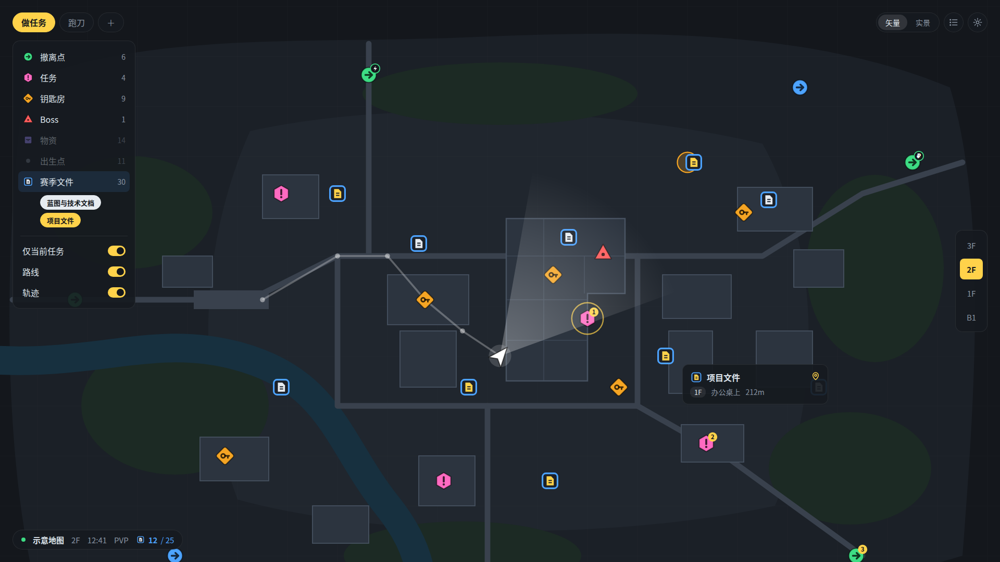

- 赛季限定的内容做成**赛季包**：一份独立的数据文件，描述本赛季有哪些东西、在哪些地图、点位在哪、每日上限是多少。程序里不写死任何赛季内容；赛季结束后换一份赛季包即可，没有赛季包时相关界面整体不出现。
- 本赛季的内容是通行证文件：8 种文件，每种在 3 张地图刷新；每日拾取上限 PVE 15、PVP 25、赛季 40。
- 界面：筛选里多一个"赛季文件"大类，子类是本图会刷的几种文件；地图上显示刷新点，点开有楼层和位置描述；状态栏显示今日已拾取数和上限，按当前档案取对应的上限。
  - 地图上的刷新点统一画成文件形状的徽章（24px 起，和撤离点、上锁的门同量级），边框按种类上色，8 种各一个颜色，同一张图会一起刷的两三种必须拉开；避开撤离点的绿、危险区的红、上锁的门的橙黄。筛选里的子类标签用同一个颜色。
  - 物品图只在详情页标题和悬停卡片里用：缩到地图上那么大就认不出是什么了。
  - 楼层对不上、按规则放到地面层的点，地图上画在地面，详情里仍显示网站写的楼层（"2F"）。
- 数据来源：https://www.eftarkov.com 的地图页有逐个刷新点（楼层、文字描述、照片）。它用的是自己地图上的像素坐标，不是游戏坐标。
- 坐标换算（原型 `prototypes/eftarkov_import.py`，结果 `prototypes/out/eftarkov_points.json`）：两边都有撤离点，用撤离点拟合出"网站坐标 → 游戏坐标"的变换。2026-11-15 实测 13 张图里 10 张换算成功，撤离点的平均偏差 3.5 到 11 米。共导入赛季文件点位 373 个、任务相关点位 710 个。
  - 这个偏差里包含了两边标注撤离点时本身的出入，实际精度应当更好，但没有单独验证过。室内找东西时主要还是靠照片和文字描述。
  - 迷宫、破冰船上游没有撤离点数据，码头没有点位，这三张图还没换算。【待定】换别的参照物，或用实机截图手动对一次。
- 物品图用上游的（8 种文件上游都有），不取该网站的图片；地图上不用物品图，见上面那条。
- 授权：该网站没有公开的授权说明，所以由 otae 直接询问了站长。2026-11-15 站长答复三项都可以使用：赛季文件刷新点的位置和描述、任务地点和任务物品的位置和描述、对应的现场照片。条件是署名"逃离塔科夫中文Wiki"并附网站链接，在界面和项目主页的显著位置标出。
- 拾取文件在日志里没有可用的记录（已查），今日计数是手动加减。

### 6.8 第二版
- 组队：每个队友都运行 otm，凭房间码加入，通过中转服务器互相转发位置。默认关闭；只传地图、位置、朝向、昵称；中转程序开源、可自建。
- 手机和平板当副屏。
- 用积累的轨迹修正路网。

## 7. 界面

原则：**不在界面上堆砌说明文字，让布局自己来解释**（已写入 AGENTS.md）。

风格：暗色扁平。底图压暗、低饱和；标注是实心彩色图标；自己的位置最醒目。

### 7.1 标注

| 类别 | 形状 | 颜色 |
|---|---|---|
| PMC 撤离点 | 上游的盾牌标志 | 绿 |
| Scav 撤离点 | 上游的盾牌标志 | 橙 |
| 共用撤离点 | 上游的盾牌标志 | 青 |
| 转移点 | 上游的盾牌标志 | 红 |
| 任务 | 六边形 | 粉 |
| 钥匙房 | 菱形 | 琥珀 |
| 物资 | 方形 | 紫 |
| Boss | 三角形 | 红 |
| 出生点 | 小圆点 | 灰 |
| 危险区 | 上游的黄色警告三角，填满，外加细红边；范围用红色斜纹画出 | 黄 |

- 标注默认没有文字，悬停或点击才显示名称和信息卡片。
- 标注密集时合并成带数字的圆，放大后散开。
- 路线是黄色虚线，目标上的黄色数字是访问顺序；轨迹是灰白折线。

### 7.2 主窗口

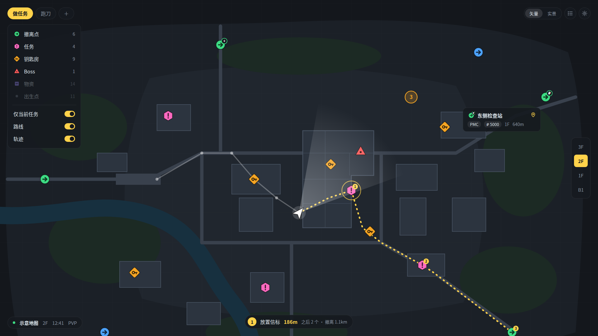

- 左上：预设；其下是大类开关和"仅当前任务、路线、轨迹"三个开关。
- 右上：底图切换、任务面板、设置。
- 右侧：楼层。
- 左下：地图、楼层、对局时间、当前档案。
- 底部中间：下一个目标和距离，之后还有几个，离撤离多远。
- 点标注弹出卡片，卡片上有"钉住"。

### 7.3 任务面板

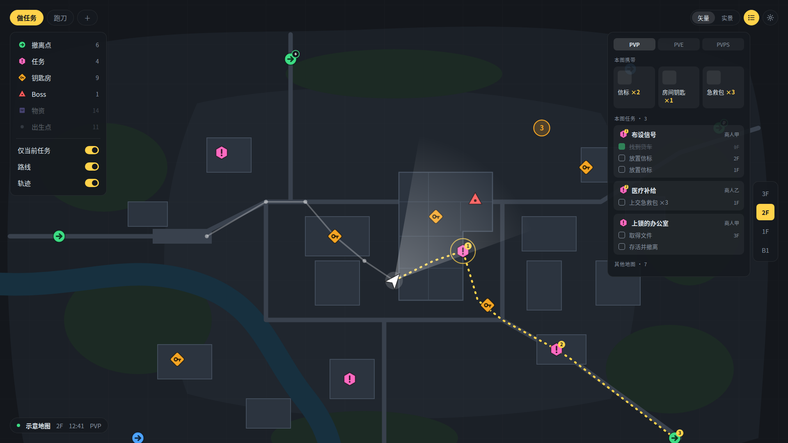

顶部三个档案；本图携带物品；本图任务及小目标；其他地图的任务折叠在最下面。

### 7.3.1 任务树

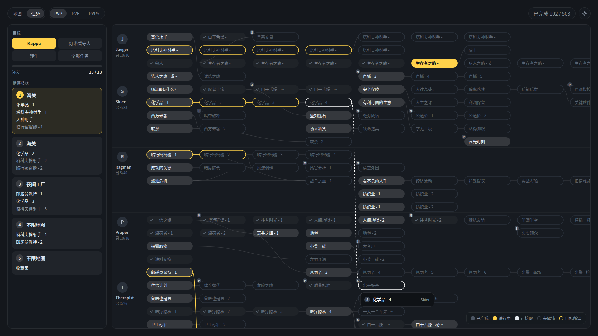

- 顶部有"地图 / 任务"的切换。
- 每个商人一条横带，从左到右是先后顺序，连线是前置关系。
- 只画有前后关系的任务；独立任务折叠成商人名字下面的数字（如"另 10/36"），点开才展开。
- 整张图只有黄色一种强调色，用于"进行中"和"目标所需"。状态靠明暗区分：已完成最暗并带勾，可接取最亮，未解锁只有轮廓。
- 跨商人的前置：任务左上角一个小圆，现在是商人名首字母，以后换成上游的商人头像。选中任务时才画出连线和前置卡片。
- 任务名过长时截断，悬停显示全名。
- 左栏：目标选择、进度、推荐路线（每一局去哪张图、做哪些任务）。
- 商人头像、任务图标用上游的，暂未处理。

### 7.3.2 详细页面

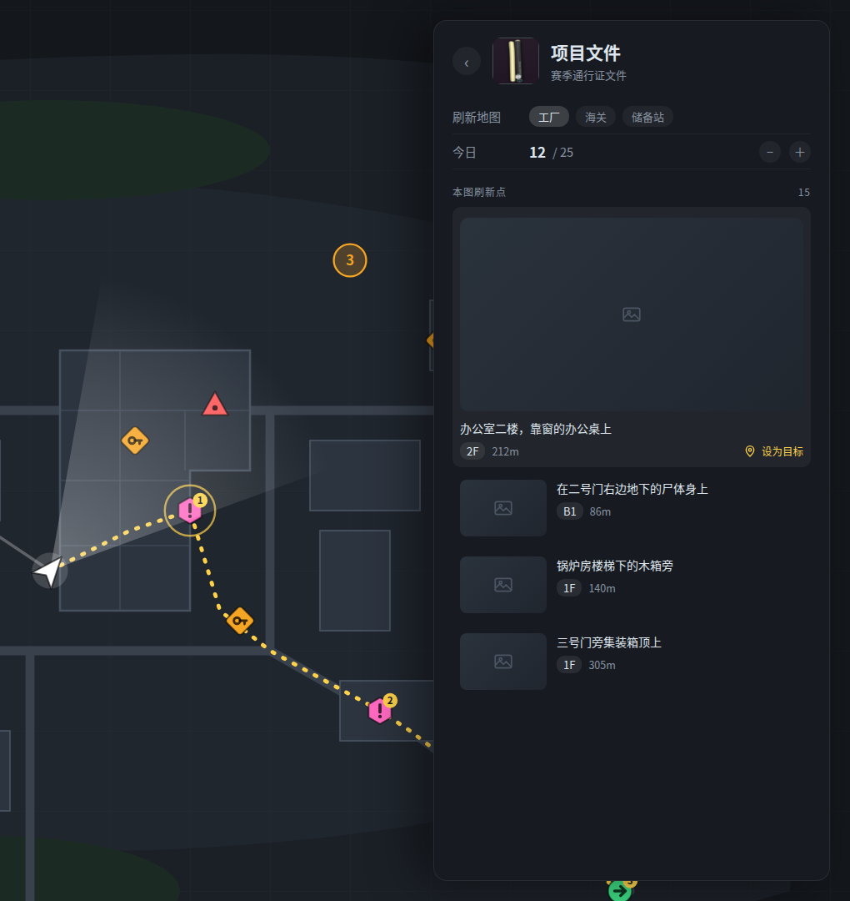
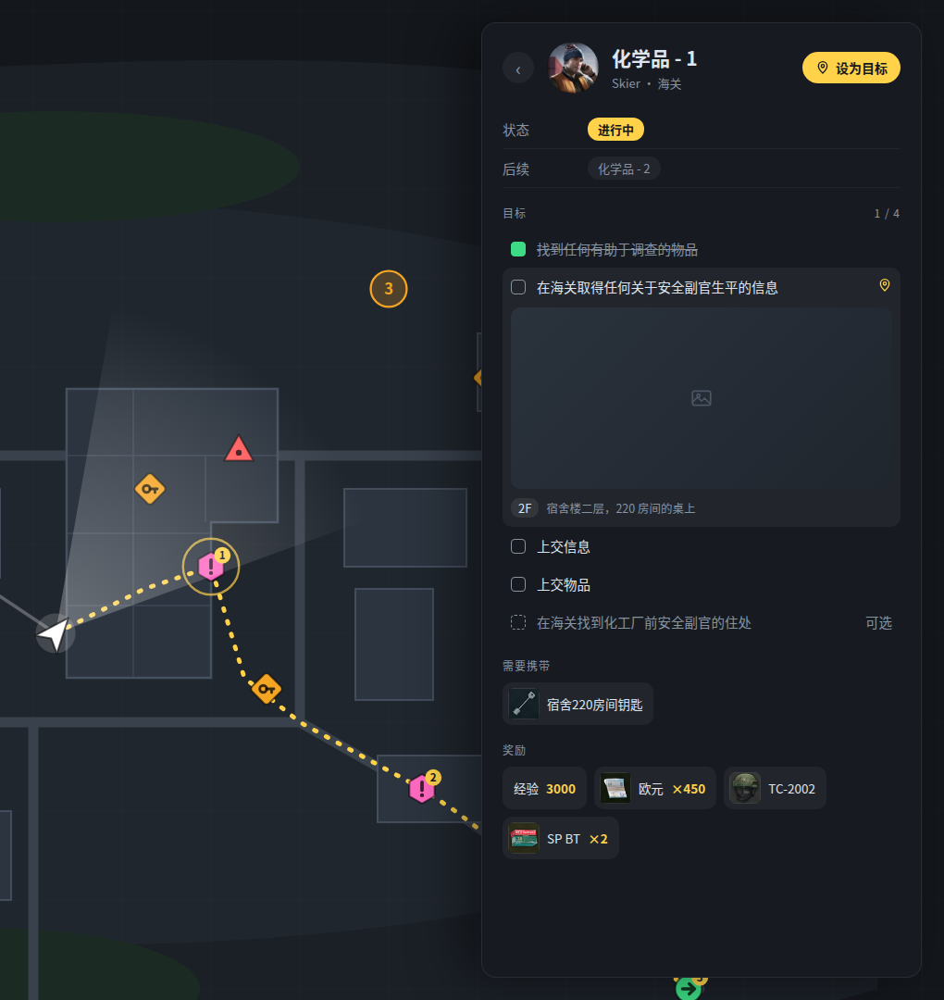

- 点击标注、任务、物品后，从右侧滑出详细页面，地图仍留在左边；左上角的箭头返回。
- 所有类型共用一个骨架：头部（图标、名称、所属）、几行属性、列表。
- 赛季文件：刷新地图、今日计数、本图刷新点列表；每个点有照片、位置描述、楼层、距离、设为目标。
- 任务：状态、前置和后续、目标列表（可勾选、可定位，展开后有位置照片和描述）、需要携带的物品、奖励。
- 同样适用于任务物品、撤离点、钥匙房、容器等。
- 热键"当前目标的详情"：在叠加层里按一下，小地图下方弹出当前目标的详情卡片（照片、名称、距离、描述、楼层），再按一下收起；在主窗口里则打开当前目标的详细页面。没有目标时显示离自己最近的标注。


- 数据来源：目标、物品、奖励、钥匙来自上游；位置照片和文字描述来自 eftarkov.com（已获站长同意，需署名）。

### 7.4 设置

分页：预设、热键、叠加层、定位、数据、档案。

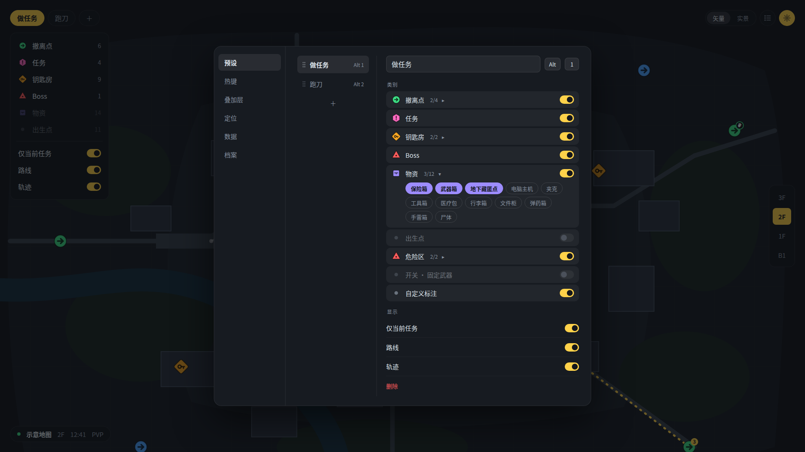
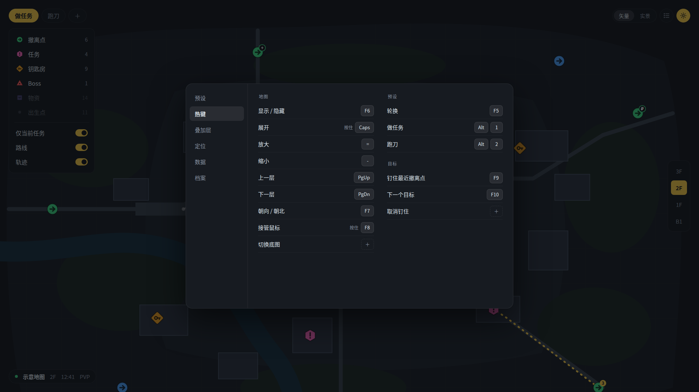
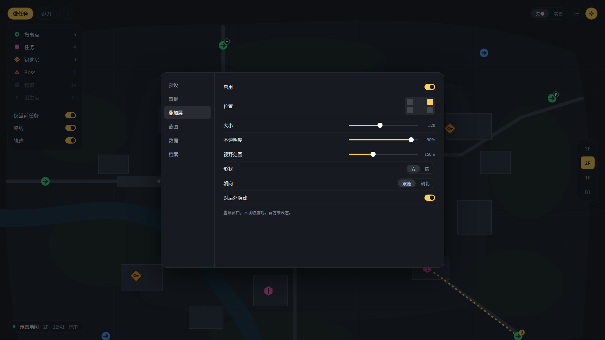

- 叠加层页可调：启用、位置、大小、不透明度、视野范围、形状、朝向、对局外隐藏。
- 风险提示只有叠加层页底部的一行。

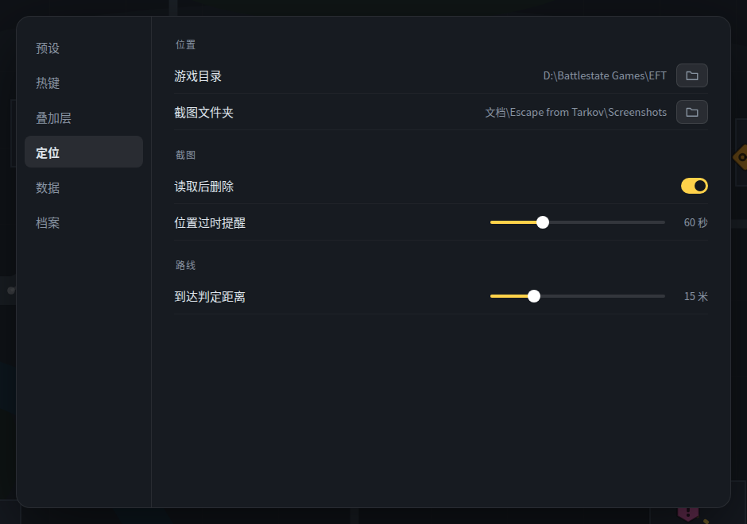
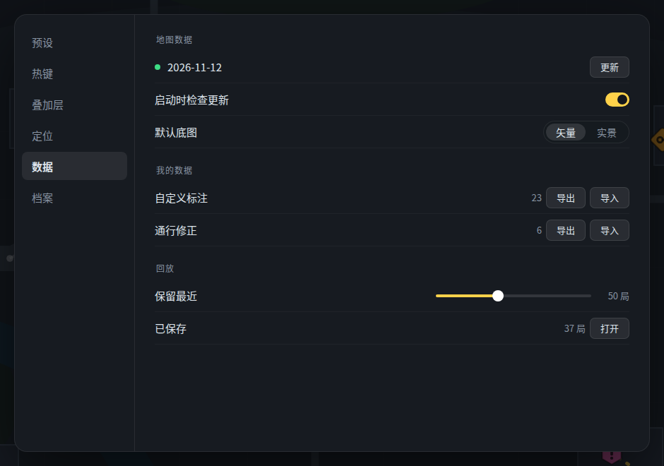
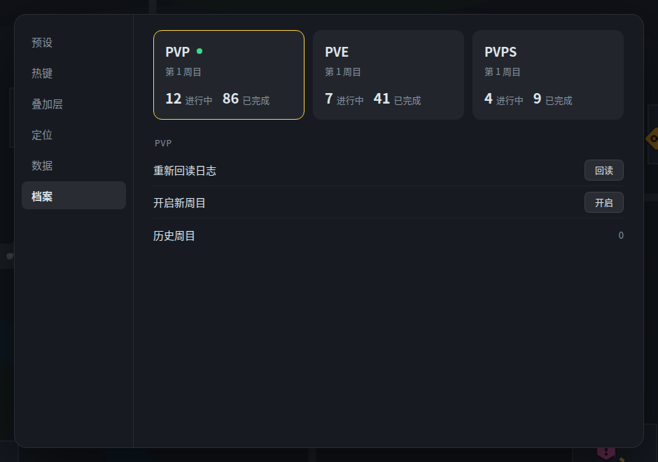

- 定位页：游戏目录、截图文件夹、读取后删除、位置过时提醒（默认 60 秒）、到达判定距离（默认 15 米）。
- 数据页：地图数据的日期和状态、手动更新、启动时检查更新、默认底图；自定义标注和通行修正的数量及导出导入；回放保留局数和打开回放。
- 档案页：三个档案各一张卡片（第几周目、进行中和已完成的任务数），当前档案高亮；对选中档案可重新回读日志、手动开启新周目、查看历史周目。
- 【待定】回放界面本身。

### 7.5 叠加层


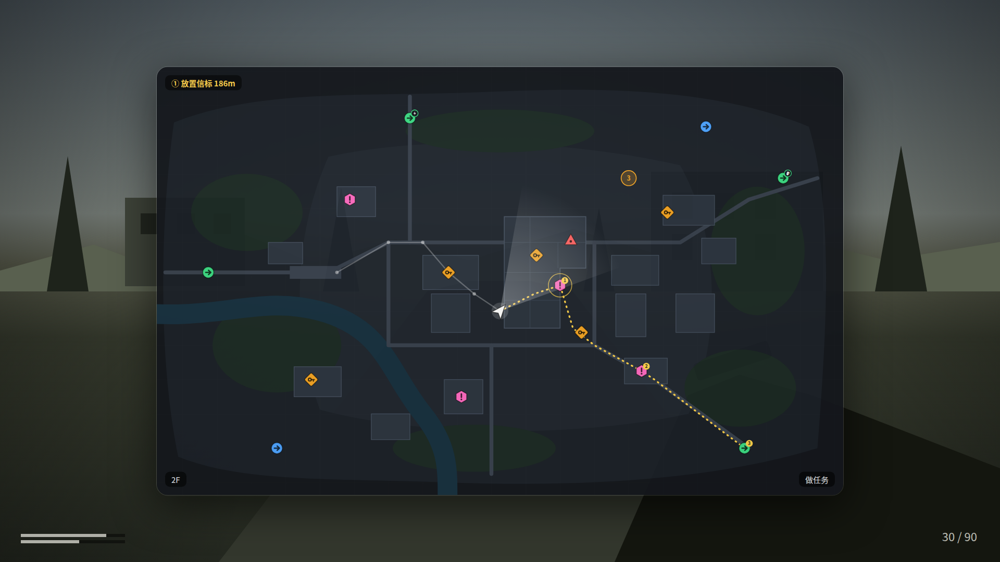

- 置顶、透明、鼠标穿透的窗口，不注入游戏。可选功能，默认关闭。
- 小地图：默认跟随朝向旋转，自己朝上。文字只有三处：下一个目标的距离、楼层、预设名。
- 展开大地图：按住展开到屏幕中央，松开收回。
- 所有操作靠热键，不需要切出游戏。
- 官方对叠加层没有明确表态，存在不确定的风险，所以窗口模式是默认和保底。

### 7.6 首次启动

没有引导流程。自动找到游戏目录和截图文件夹，后台回读历史日志（期间地图照常可用，任务面板显示进度），直接进入窗口模式。只有自动查找失败时才出现一个选目录的输入框。

### 7.7 对局外的主窗口

- 显示上一局打的那张图，可以自由浏览。
- 左下角状态栏的地图名可以点，点开是一排地图供切换。
- 任务面板照常可用，"本图携带"就是出发前的检查清单。
- 日志里出现新的一局时，自动切到那张图；手选只是看看，新的一局来了就回到跟着对局走。
- 轨迹跟着它所属的地图走：看别的图时收起来；日志还没读到、不知道玩家在哪张图时，换图就把上一张图的轨迹丢掉。

### 7.8 状态

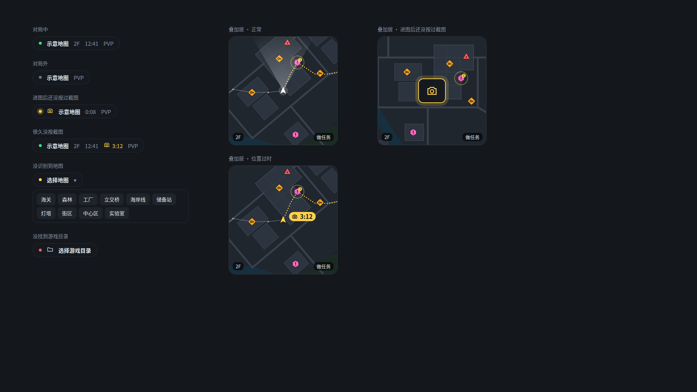

所有状态只靠主窗口左下角的状态栏表达，不弹窗、不遮挡地图。

| 情况 | 圆点 | 状态栏 | 其他表现 |
|---|---|---|---|
| 对局中 | 绿 | 地图、楼层、时间、档案 | |
| 对局外 | 灰 | 地图、档案 | |
| 进图后还没按过截图 | 黄，带光晕 | 多一个相机图标 | 地图上不画自己；叠加层小地图不旋转，中间显示一个相机键 |
| 位置过时 | 绿 | 多一个相机图标和距上次截图的计时 | 自己的箭头变黄、去掉视野锥，旁边一个放大的"相机 + 计时"标签；叠加层和主窗口相同 |
| 没识别到地图 | 黄 | "选择地图"，点开是地图列表 | |
| 没找到游戏目录 | 红 | 文件夹图标、"选择游戏目录" | 唯一会挡住使用的情况 |
| 数据更新失败 | 不变 | 不显示 | 只在设置的"数据"页里标出 |

- 多久算位置过时：默认 60 秒，可调。

### 7.9 尚未设计的界面【待定】

- 实景底图下的样子

## 8. 热键

- 全部可自定义。支持鼠标侧键，但默认键位只用键盘。
- 默认键位等做出来后对照实际游戏键位再定。

| 操作 | 方式 |
|---|---|
| 显示 / 隐藏叠加层 | 按一下 |
| 展开大地图 | 按住 |
| 放大、缩小 | 各一个键 |
| 上一层、下一层 | 各一个键 |
| 随朝向旋转 / 固定朝北 | 按一下切换 |
| 让叠加层临时接管鼠标 | 按住 |
| 预设轮换 | 按一下 |
| 切到某个预设 | 每个预设可单独绑定 |
| 切换底图 | 按一下 |
| 钉住最近撤离点、下一个目标、取消钉住 | 各一个键 |
| 当前目标的详情 | 按一下弹出，再按一下收起 |

刷新位置用的是游戏自己的截图键，不归 otm 管。

## 9. 交付阶段

| 阶段 | 内容 |
|---|---|
| 0 | 三个验证实验 |
| 1 | 窗口模式能用：识别地图、显示位置和楼层、类别筛选和预设 |
| 2 | 叠加层：小地图、展开大地图、热键 |
| 3 | 任务：同步已接任务、任务点筛选、物品提醒 |
| 4 | 指向、轨迹、路线、自定义标注 |

每个阶段结束都能拿去打一局。

## 10. 验证实验

1. 置顶透明窗口在全屏的塔科夫上能不能显示，会不会导致掉帧或跳出。不行就要求无边框窗口模式。
2. 不碰游戏进程的前提下，能不能稳定检测按键松开。不行的话"按住展开"改为"按一下展开，再按一下收回"。
3. 在一张图上试路线算法的质量。效果好就进第一版，效果差就只保留访问顺序和指向，路线标为实验功能。

## 11. 定稿后的事

- 建代码仓库。代码用 MIT 协议；地图素材仍按其原授权（CC BY-NC-SA 4.0）单独标注，不随代码改为 MIT。
- 按第 9 节的阶段开发。
